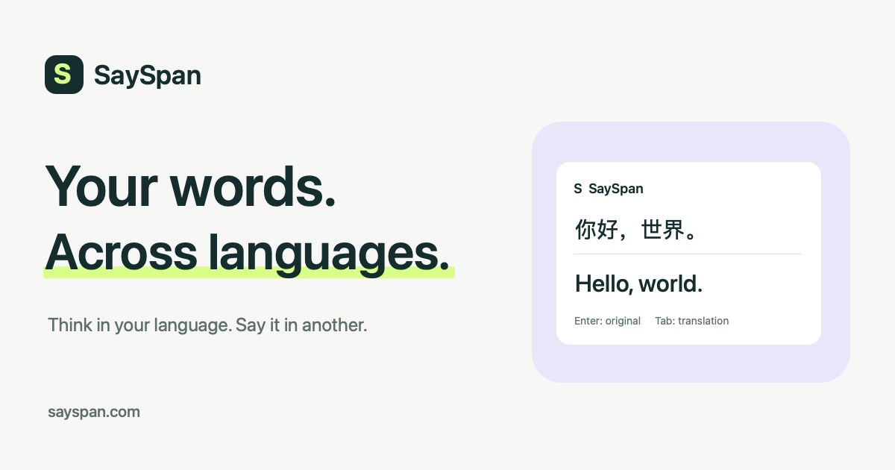

# SaySpan

**Write in your language. Say it in another.**

SaySpan is an open-source macOS input method that combines native typing, sentence
composition, and translation in the application you are already using. Compose a
sentence, review its translation, then insert the original or translated text.
You can also translate selected text in other applications.

[Website](https://sayspan.com) · [English guide](https://sayspan.com/en/docs/) ·
[中文文档](https://sayspan.com/zh/docs/) · [Build from source](docs/development/macos.md) ·
[Contributing](CONTRIBUTING.md)



## What it does

- **Bilingual sentence composition:** Chinese pinyin and Japanese romaji candidates,
  an editable sentence, and an asynchronous translation preview.
- **A configurable language pair:** Caps Lock off uses your first language; on uses
  your second. Translation detects either language and targets the other.
- **Direct English typing:** English goes straight into the focused field. Select
  existing English text when you want to translate it.
- **Sentence editing:** candidate navigation, expandable candidate rows, caret
  movement, Shift + arrow selection, copy/cut/paste/undo, and local vocabulary learning.
- **Selection translation:** a small translation button or an automatic result card,
  with optional macOS Accessibility permission.
- **Your choice of model:** local Ollama or a configurable OpenAI-compatible API,
  with model selection, reasoning controls, and an editable translation prompt.
- **Localized interface:** English and Simplified Chinese, following the system
  language by default.

Translation languages and typing engines are separate. Chinese and Japanese have
candidate engines; other supported layouts depend on the language and macOS layout
availability. Native Korean composition is not implemented. See the
[language guide](https://sayspan.com/en/docs/languages/) for the current scope.

## Status and installation

This is an early **macOS / Apple Silicon** project. The portable build targets
**macOS 15 and later**; Intel macOS and Linux are not supported. A separate
[Windows x64 preview](apps/windows/README.md) implements English direct typing
and Chinese pinyin sentence composition; translation is not yet ported.
The source includes the bilingual website and development installer tooling.

There is currently **no signed, notarized public installer**. The included packaging
script produces an ad-hoc-signed development DMG, which macOS may block after a
browser download. Successful local tests do not establish clean-machine installation
or compatibility with every supported macOS version. See [the macOS build guide](docs/development/macos.md)
for development installation, packaging, and validation limits.

Ollama, model weights, and API credentials are not bundled. Configure an existing local
Ollama service or your own online provider in **Settings → Models**.

## Quick development build

On an Apple Silicon Mac with Xcode command-line tools, Homebrew, and Python 3.9+:

```bash
git clone https://github.com/Ethan-Infcos/SaySpan.git
cd SaySpan
brew install librime opencc
bash apps/macos/build.sh
python3 apps/macos/Tools/Test.py
```

The development script currently defaults to a **macOS 27** deployment target and
uses your Homebrew libraries. For a self-contained macOS 15+ build, use the
[pinned dependency and DMG workflow](docs/development/macos.md#portable-dmg).
Building and testing do not install or restart your active input method.

## Basic workflow

1. Install the built app and add **SaySpan** in **System Settings → Keyboard →
   Text Input → Edit → + → Others**.
2. Open SaySpan's settings from the input menu. Choose a model and your first/second
   languages; the defaults are English and Simplified Chinese.
3. Press the physical Caps Lock key to change between those two languages.
4. Compose with candidates. Once the pending candidate is resolved, **Enter** inserts
   the source sentence and **Tab** inserts a ready translation. If a raw Latin segment
   is pending, Enter first keeps those letters in the draft for mixed-language text.
5. For selection translation, enable the feature and grant SaySpan Accessibility
   permission. Select text outside an editable input field, then click **译** or use
   automatic display.

Read the [writing guide](https://sayspan.com/en/docs/writing/) for navigation and
mixed-language input, and the [selection guide](https://sayspan.com/en/docs/selection/)
for permission and application compatibility details.

## Privacy

Typing uses InputMethodKit. The optional external selection translator uses
Accessibility. Translation text is sent to the model endpoint you configure;
choosing an online API sends it to that provider. API keys are stored in macOS
Keychain. Learning data stays in your user Library. See [SECURITY.md](SECURITY.md)
and the [privacy guide](https://sayspan.com/en/docs/privacy/).

## Platform support

| Platform | Status | Source |
| --- | --- | --- |
| macOS, Apple Silicon | Development preview; portable target macOS 15+ | `apps/macos/` |
| Windows, x64 | Input/composition preview; desktop testing required | `apps/windows/` |
| Linux | Planned; no implementation yet | Future `apps/linux/` |

See [platform organization](docs/platforms.md) for boundaries and shared contracts.

## Source layout

| Path | Purpose |
| --- | --- |
| `apps/macos/Sources/` | Native input-method runtime, composition, engines, translation, and settings |
| `apps/macos/Tests/` | Nine executable regression suites plus opt-in live-model fixtures |
| `apps/macos/Resources/` | Branding, localized strings, bundle metadata, and Rime schemas |
| `apps/macos/Vendor/` | Upstream Japanese dictionary/schema and license notices |
| `apps/macos/Tools/`, `apps/macos/Packaging/` | Build, tests, dependency pinning, library audit, and installer templates |
| `website/` | Portable bilingual static website source |
| `docs/` | Build and architecture documentation |

See [architecture.md](docs/architecture.md) for module boundaries and behavior contracts.
Stable internal IDs retain historical `DualLineIME` / `vokira` names so upgrades
preserve preferences, credentials, and learned vocabulary. They are not display branding.

## License

Original SaySpan code is licensed under the [MIT License](LICENSE).
Bundled dictionaries, schemas, and dependencies retain their own licenses; see
[THIRD_PARTY_NOTICES.md](THIRD_PARTY_NOTICES.md). Model weights are not included and
are governed by their respective providers' licenses.
